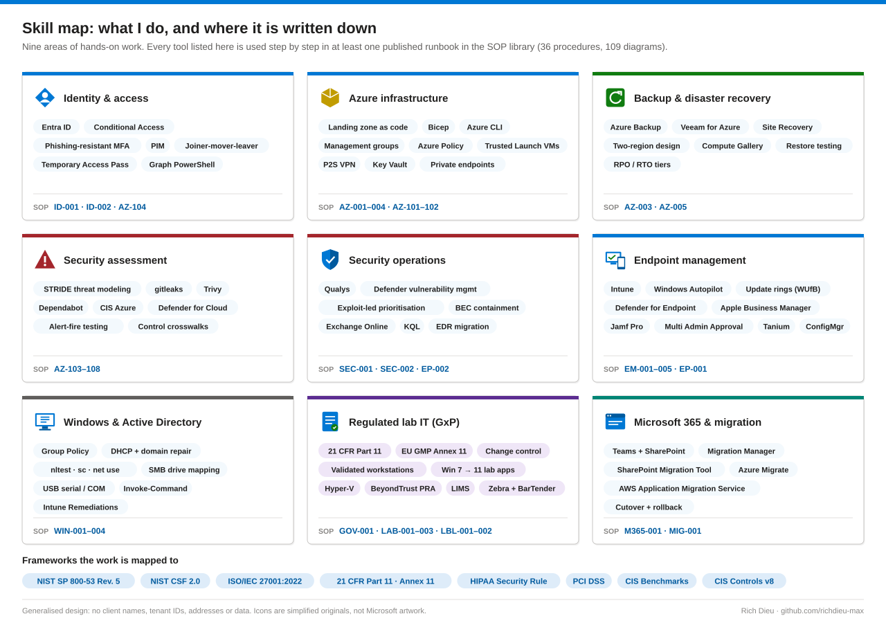
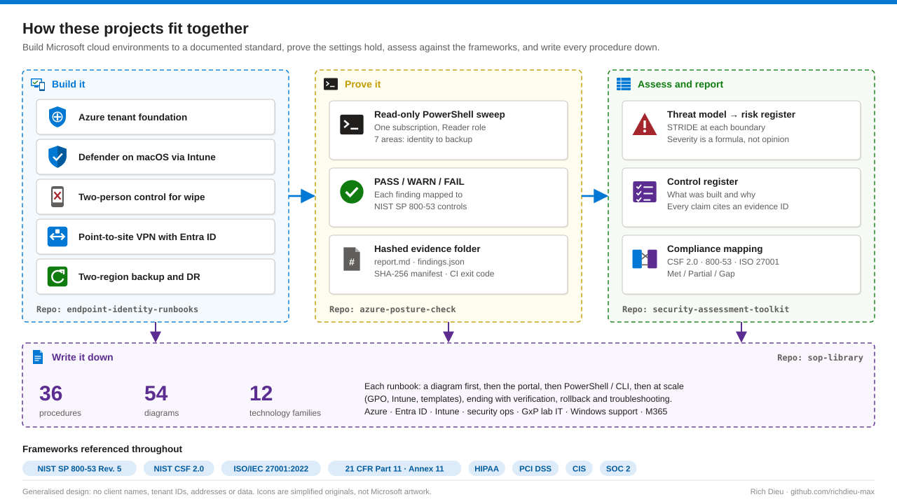

## Rich Dieu

**Cloud, Identity & Endpoint Security Engineer · Azure · Entra ID · Intune · Microsoft 365 · NIST 800-53 · GxP**

I build and secure Microsoft cloud environments for organisations that get audited: pharmaceutical and biotech R&D, legal, and compliance software. About seven years in, from help desk to system administration to cloud and security engineering, with the same habit throughout: if it isn't documented and evidenced, it isn't done. The [SOP library](https://github.com/richdieu-max/sop-library) is the proof: 36 runbooks with 54 architecture and flow diagrams, each one written from work I have done.

**What I work on**

- **Identity & access:** Entra ID, Conditional Access, phishing-resistant MFA, PIM and just-in-time access, joiner-mover-leaver lifecycle, Temporary Access Pass, hybrid identity, federated SSO (SAML, OIDC)
- **Azure infrastructure:** tenant and landing-zone builds as code (Bicep, Azure CLI, PowerShell), management groups, Azure Policy guardrails, Trusted Launch VMs, point-to-site VPN, Key Vault, private endpoints
- **Backup & DR:** Azure Backup, Veeam Backup for Azure, Azure Site Recovery, two-region designs with tested RPO/RTO
- **Security assessment:** STRIDE threat modeling, secrets and supply-chain scanning (gitleaks, Trivy, Dependabot), network segmentation reviews against CIS and Defender for Cloud, logging validation with KQL, control crosswalks
- **Security operations:** vulnerability remediation with Qualys and Microsoft Defender, business email compromise containment in Entra ID and Exchange Online, EDR migrations
- **Endpoint management:** Intune for Windows and macOS, Windows Autopilot, update rings (WUfB), Defender for Endpoint, Apple Business Manager and Jamf Pro, Tanium, ConfigMgr, Multi Admin Approval
- **Windows & Active Directory:** Group Policy, DHCP and domain repair, SMB and mapped drives, USB serial devices, remote fixes with Invoke-Command and Intune Remediations
- **Regulated lab IT (GxP):** 21 CFR Part 11 and EU GMP Annex 11 change control, validated workstations, lab application modernisation (Windows 7 to 11, Hyper-V), compliance data agents, BeyondTrust PRA, LIMS, Zebra and BarTender label printing
- **Microsoft 365 & migration:** file shares to Teams and SharePoint (Migration Manager, SPMT), server rehosting with Azure Migrate or AWS Application Migration Service
- **Automation:** PowerShell and Microsoft Graph, read-only evidence collection, Python for reporting
- **Frameworks:** NIST SP 800-53 and CSF 2.0, ISO/IEC 27001, 21 CFR Part 11 and ALCOA+ data integrity, HIPAA Security Rule, PCI DSS, CIS Benchmarks and Controls

### Projects

| Project | What it is |
|---|---|
| [sop-library](https://github.com/richdieu-max/sop-library) | 36 runbooks with 54 diagrams across Azure, Entra ID, Intune, security operations, GxP lab IT and Windows support: portal steps, PowerShell / CLI, at-scale methods, verification, rollback and control mapping |
| [azure-posture-check](https://github.com/richdieu-max/azure-posture-check) | Read-only PowerShell posture check for an Azure subscription: PASS/WARN/FAIL per control, NIST mapping, SHA-256 evidence manifest, Pester tests in CI |
| [security-assessment-toolkit](https://github.com/richdieu-max/security-assessment-toolkit) | The workbook behind my assessments: threat model, risk register with formula-driven severity, control register, compliance mapping, logging validation |
| [endpoint-identity-runbooks](https://github.com/richdieu-max/endpoint-identity-runbooks) | Short-form runbooks with architecture diagrams and control mappings |

**Runbooks**

| Runbook | What it covers |
|---|---|
| [Azure tenant foundation](https://github.com/richdieu-max/endpoint-identity-runbooks/blob/main/runbooks/azure-tenant-foundation.md) | Break-glass accounts, MFA, domain, management groups and policy |
| [Point-to-site VPN with Entra ID sign-in](https://github.com/richdieu-max/endpoint-identity-runbooks/blob/main/runbooks/azure-p2s-vpn-entra-id.md) | Admin access to private VMs through an MFA-protected tunnel |
| [Two-region backup and DR design](https://github.com/richdieu-max/endpoint-identity-runbooks/blob/main/runbooks/azure-backup-dr-two-region.md) | 4-hour recovery points, immutable off-site copies, tiered RPO/RTO |
| [Defender for Endpoint on macOS via Intune](https://github.com/richdieu-max/endpoint-identity-runbooks/blob/main/runbooks/macos-defender-for-endpoint-via-intune.md) | Zero-prompt onboarding of managed Macs |
| [Two-person control for device wipe](https://github.com/richdieu-max/endpoint-identity-runbooks/blob/main/runbooks/intune-multi-admin-approval-device-wipe.md) | Intune Multi Admin Approval for wipe, retire and delete |

**Certifications:** Microsoft SC-300 Identity and Access Administrator · CompTIA Security+ (in progress)

**Elsewhere:** [richdieu.com](https://richdieu.com) · [LinkedIn](https://www.linkedin.com/in/richdieu)

Everything here is generalised from real work. No client or employer names, tenant identifiers, addresses or data appear in these repositories.
