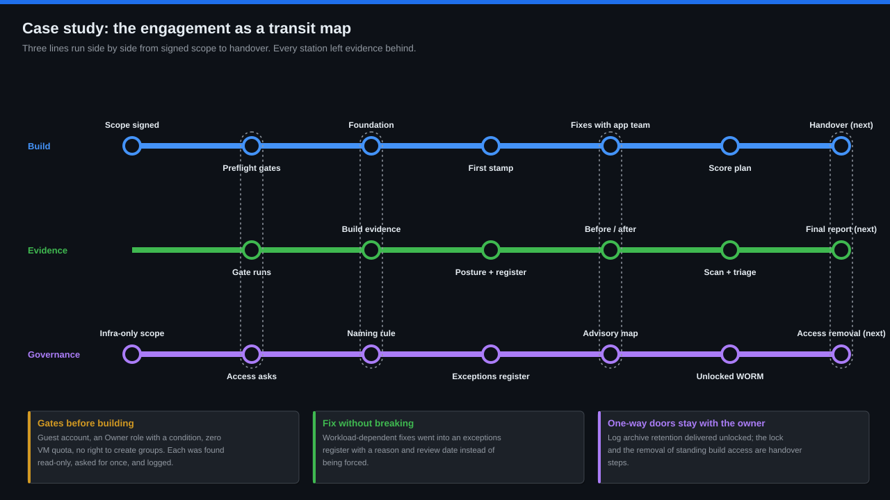

# Case study: building and validating an Azure tenant for a SaaS launch

*Sanitized. No client, product, person, tenant or subscription detail appears here. The engagement is still running; the last stations on the map below are what comes next.*

## The ask

A SaaS company preparing to launch needed its Azure tenant built and its infrastructure validated before real customers arrived. The signed scope was **infrastructure only**: build the tenant foundation and the first customer environment, then validate architecture, identity, secrets, network, logging and compliance mapping. Application code review and penetration testing were separate, optional add-ons. Keeping that line clear decided what I fixed, and what I wrote down and handed to the application team.

The work ran as two independent workstreams with a second consultant, so the person who built a control was never the only one who judged it.

## What I built

- **A landing zone with customer stamps.** Management groups with guardrail policies, a shared foundation (hub network, WAF policy, logging, alerting) and one isolated, identical environment per customer. Pattern: [landing-zone-stamp](https://github.com/richdieu-max/endpoint-identity-runbooks/tree/main/landing-zone-stamp).
- **A naming rule** where every resource name carries the product, workload, environment, region, type and instance, so a name alone tells you what something is and whose it is.
- **Secrets that never touch disk.** The workload VM reads its secrets from a Key Vault with public access disabled, through a private endpoint, using its own managed identity with read-only rights.
- **A tamper-evident log archive** with multi-year write-once retention. Pattern: [logging](https://github.com/richdieu-max/security-assessment-toolkit/tree/main/logging).
- **Versioned build packages**, each with a change log, so every state of the build could be reproduced and compared.

## What got in the way, and what I did about it

| Blocker | What it taught me | What I do now |
|---|---|---|
| I worked from a guest account | Guests usually cannot create the security groups a build assigns roles to, and Azure Owner is not a directory role | The preflight checks it and names the role that can open it |
| My Owner role carried a condition | A conditioned Owner can deploy resources but cannot make the build's own role grants | Checked before building, not discovered half way |
| The new subscription had zero VM quota and a restricted VM family | The two most common reasons a first deployment stops | Quota and SKU checks in the same preflight |
| The subscription already held workloads the build did not own | Every check had to be scoped by name prefix, or it would grade someone else's resources | Prefix and scope are parameters in every script |
| Some fixes would have broken the running application | Turning off shared keys or public access is easy; finding out what depended on them is the work | An exceptions register: reason, deciding role, review date. Excepted fixes are reported, never forced |

The asks for access went out once, in one list, and each preflight run was kept as evidence. That record is also what showed when access was actually ready, which matters when a delivery clock starts at access, not at signature.

These became the [preflight gates](https://github.com/richdieu-max/endpoint-identity-runbooks/tree/main/landing-zone-stamp#preflight-gates).

## How I proved it

- **Read-only checks with hashed evidence.** A posture check and a tenant hardening assessment, every run in its own folder with a SHA-256 manifest. [azure-posture-check](https://github.com/richdieu-max/azure-posture-check)
- **A control register of over a hundred rules**, graded automatically. My own rules as data, not a checklist in a document. [rule-register](https://github.com/richdieu-max/azure-posture-check/tree/main/rule-register)
- **Registers that feed each other.** Threat model, risk register, control register and compliance mapping in one workbook, with owners recorded as roles, never names. [security-assessment-toolkit](https://github.com/richdieu-max/security-assessment-toolkit)
- **Supply-chain scans** (secrets, vulnerabilities, SBOM, dependency alerts) triaged into what infrastructure fixes and what gets routed to the application team. [supply-chain-scan](https://github.com/richdieu-max/security-assessment-toolkit/tree/main/supply-chain-scan)
- **Alerts tested end to end.** A rule counted only when someone received the alert.

## How I fixed things without breaking them

Fixes ran in phases from safest to riskiest, each tested before and after, each change confirmed first: [remediation](https://github.com/richdieu-max/azure-posture-check/tree/main/remediation). The same engine ordered a Secure Score plan so the quick, invisible wins came first and anything that could touch the application waited for its owner. When a threat advisory arrived, it was translated into techniques, controls, checks and only then fixes, inside the same process.

## Decisions I left with the owner on purpose

- **Locking the log archive.** Write-once retention was delivered unlocked. Locking can never be undone, so it is the system owner's written decision, with a guarded script ready.
- **Removing my own access.** Standing build access is removed at handover, and the removal is part of the evidence.

## What I would tell the next team

1. Run the preflight before you sign a start date, not after.
2. Write your rules down as data. A register you can grade is worth more than a policy document nobody runs.
3. Every "fixed" needs an after-test, and every "already met" needs evidence too.
4. Stay in your lane, and write down everything you see outside it.
